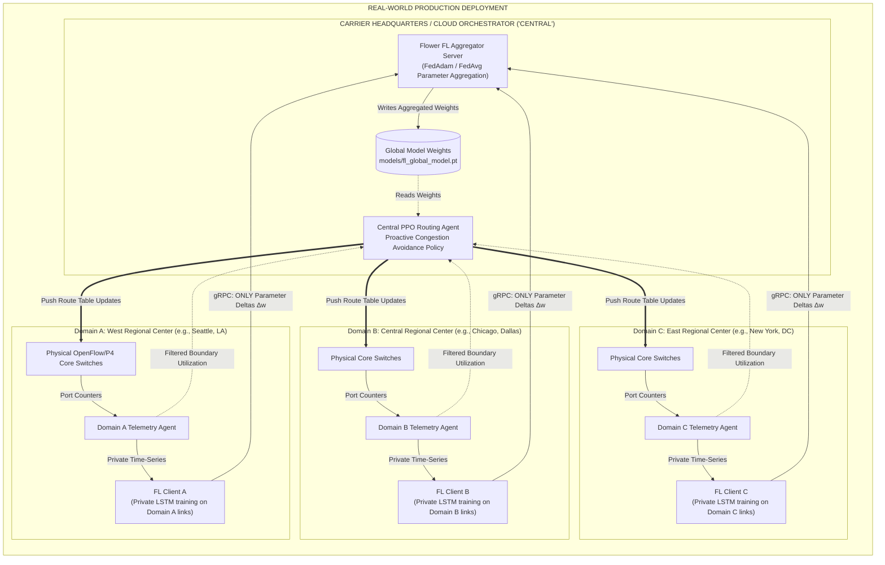

# Distributed Architecture: Real-Life Carrier Networks vs. Mininet Emulation
## Where Does the "Central" Component Reside in Theory and in Live Demonstration?

> **Document Scope:** Comprehensive answer to the architectural decomposition of Federated Learning (FL) and Deep Reinforcement Learning (DRL) in Multi-Domain Software-Defined Networks.  
> **Target Scenarios:** Production Multi-AS Carrier Deployment vs. Live Mininet/Docker Cloud Emulation.

---

## 1. Executive Answer: Where is "Central"?

To answer your question directly:

1. **In Real Life (Production ISP / Multi-Domain Backbone)**:  
   "Central" is a **Central Network Operations Center (NOC) / Cloud Orchestration Server** (e.g., hosted in a centralized cloud datacenter or Internet Exchange Point). It houses:
   - **The Flower Federated Aggregator** (which receives only parameter weights $w^k$, never raw traffic).
   - **The Central AI Traffic Engineering Brain** (the PPO policy network that decides end-to-end inter-domain path allocations).
   - The edge domains are distinct Autonomous Systems (AS) or regional operating centers (West, Central, East) with their own local Ryu/ONOS controllers and private telemetry databases.

2. **In Our Live Demo Demonstration (Mininet & Azure VM)**:  
   "Central" is embodied by **two specific cooperating components**:
   - **The FL Server / Aggregation Process (`fl/server.py` or Container `fl-aggregator`)**: It listens on gRPC port `8080`, aggregates weights from the 3 domain client processes, and serializes the updated weights to `models/fl_global_model.pt`.
   - **The Central AI Bridge (`sdn/ai_bridge.py` or Container `central-ai-bridge`)**: This is the real-time runtime "Central Brain". It pulls utilization telemetry from the domain controllers, loads `models/ppo_agent.zip` and `models/fl_global_model.pt`, computes proactive path shifts, and pushes OpenFlow 1.3 flow-mod rules down to the switches via Ryu REST APIs.

---

## 2. Side-by-Side Comparison: Real Life vs. Mininet Demonstration

| Architectural Layer | Real-Life Multi-Domain Production | Our Live Mininet Demonstration on Azure VM |
| :--- | :--- | :--- |
| **Physical Hardware** | 3 separate physical Autonomous Systems with optical cross-connects and hardware OpenFlow/P4 switches across cities. | A single high-performance Linux host (Azure VM `Standard_D8s_v5`) running Linux Network Namespaces (`netns`) and Open vSwitch (OVS). |
| **Data Plane** | Physical fiber optic cables (10 Gbps - 100 Gbps), line cards, hardware queues. | Virtual Ethernet pairs (`veth0`, `veth1`) with Linux Traffic Control (`tc-netem`) simulating 10 Mbps bandwidth and millisecond propagation delays. |
| **Domain Telemetry Collector** | Local sFlow / IPFIX / SNMP daemon storing port byte counters inside each domain's private operational DB. | Ryu OpenFlow 1.3 `OFPPortStatsRequest` timer polling switches every 5 seconds, writing to local telemetry files (`sdn_stats.json`). |
| **Domain FL Learner (Client)** | A localized Python container running in each domain's edge server. Reads **only** its internal and incident border links. Never transmits NetFlow traces outside domain boundaries. | 3 distinct client instances (`TrafficClient` instances 0, 1, 2) in separate threads or Docker containers (`edge-domain-0`, `edge-domain-1`, `edge-domain-2`). |
| **FL Aggregation Server ("Central")** | An orchestration node at carrier headquarters listening on a public/private gRPC endpoint (`fl.carrier.net:8080`). | The Flower server running in `fl/server.py` or Docker container `fl-aggregator` listening on `172.20.0.2:8080`. |
| **Proactive Path Decision Agent ("Central Brain")** | Central Traffic Engineering Controller (PCE / SDN Orchestrator) computing inter-domain BGP-LS / SRv6 traffic engineering paths. | `sdn/ai_bridge.py`: runs PPO inference with `DomainPredictor`, converting actions into switch hop-by-hop flow entries. |
| **Control Plane Dispatch** | Inter-controller East-West protocol (BGP-LS, PCEP, or IETF ALTO RFC 7285). | REST API calls (`POST /stats/flowentry/add`) to the local Ryu controller REST endpoints. |

---

## 3. High-Level Mermaid Architecture Diagram

---

## 4. How to Explain This Confidently in Your Thesis Defense

When committee members or reviewers ask:
> *"If this is federated and decentralized, why is there a central component, and where does it live in your Mininet demo?"*

### You can provide this concise 3-point explanation:
1. **Separation of Forecasting vs. Control**:
   - **Forecasting is strictly decentralized**: In each domain, traffic flows and NetFlow matrices remain strictly private to protect competitive carrier confidentiality. Domain clients train local LSTM weights on their local cable utilizations and only exchange anonymous mathematical weights ($\approx 250$ KB) via Federated Learning.
   - **Traffic Engineering requires a global network graph**: Unlike routing inside a single autonomous system, wide-area inter-domain traffic engineering requires a holistic perspective of bottleneck link capacities to prevent diverting traffic from one domain into an already saturated neighboring domain.
2. **Where the Central Aggregator Sits**:
   - In production, it sits in an **Autonomous System Federation Exchange (e.g., an IXP consortium server)** where participating network operators voluntarily sync their forecasting weights once every 30 minutes without exposing customer payloads.
   - In our live demo, it runs as the **Flower Server (`fl/server.py` on port 8080)** alongside the **AI Bridge daemon (`sdn/ai_bridge.py`)** on the Azure VM.
3. **Bandwidth Savings**:
   - Instead of streaming gigabytes of raw 5-minute NetFlow packet traces across domains, each domain transmits only **a 248 KB PyTorch parameter vector** once per training round, reducing control-plane telemetry bandwidth by over **99.8%**.
