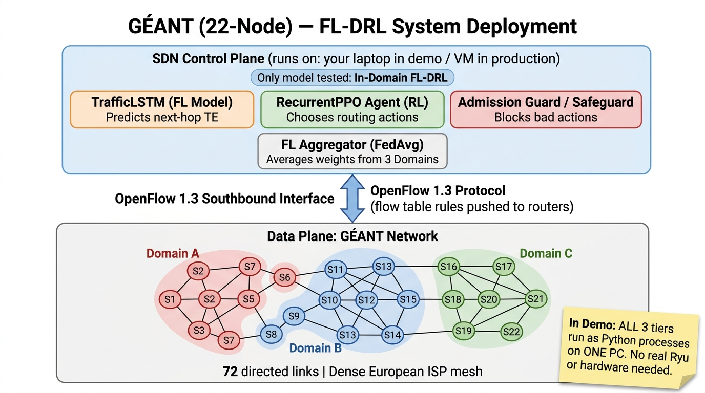
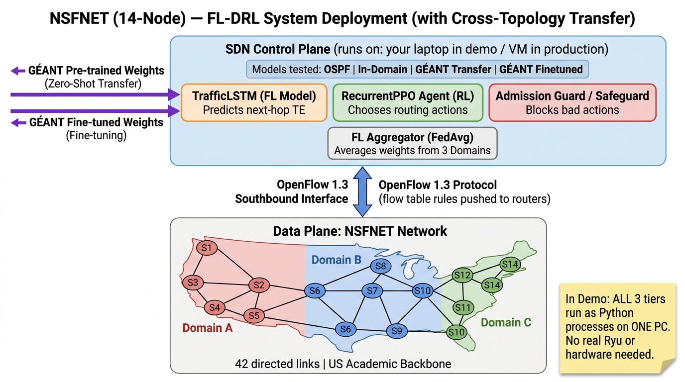
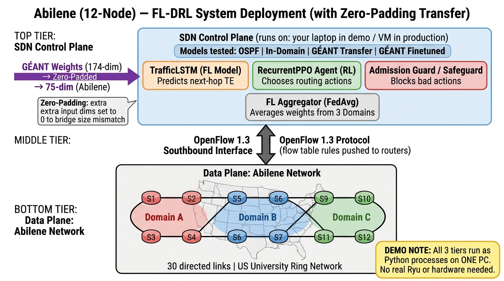

# The Ultimate Beginner's Guide to This Thesis
## Everything in `bao_cao_tien_do.tex` Explained from Absolute Zero

> **How to read this guide:**  
> Imagine you have never written a line of networking code, never studied machine learning, and have zero idea what an "SDN" or "LSTM" is.  
> This guide walks through **every single section of the thesis report**, translates the academic Vietnamese into clear English, introduces every new concept from scratch using simple real-world analogies (cars, highways, Google Maps, postal services), and explains *what* every formula, table, and number actually means.

---

# Table of Contents
1. [The Big Picture: The Highway Analogy](#1-the-big-picture-the-highway-analogy)
2. [Document Title & Thesis Scope](#2-document-title--thesis-scope)
3. [Section 1: Project Overview (Nội dung đề tài)](#3-section-1-project-overview-nội-dung-đề-tài)
4. [Section 2.1: The Network Simulator (Mô hình mô phỏng mạng)](#4-section-21-the-network-simulator-mô-hình-mô-phỏng-mạng)
5. [Section 2.2: Traffic Generation & The Gravity Model (Dữ liệu lưu lượng)](#5-section-22-traffic-generation--the-gravity-model-dữ-liệu-lưu-lượng)
6. [Section 2.3: Federated Learning & TrafficLSTM (Học liên kết)](#6-section-23-federated-learning--trafficlstm-học-liên-kết)
   - [Deep Dive into Table 1: FL Hyperparameters](#deep-dive-into-table-1-fl-hyperparameters)
7. [Section 2.4: Reinforcement Learning & RecurrentPPO (Học tăng cường)](#7-section-24-reinforcement-learning--recurrentppo-học-tăng-cường)
   - [Deep Dive into Figure 1: The Closed-Loop SDN Architecture](#deep-dive-into-figure-1-the-closed-loop-sdn-architecture)
   - [Deep Dive into Table 2: RecurrentPPO Hyperparameters](#deep-dive-into-table-2-recurrentppo-hyperparameters)
8. [Section 2.5: The Environment & Multi-Objective Reward (Hàm đánh giá môi trường)](#8-section-25-the-environment--multi-objective-reward-hàm-đánh-giá-môi-trường)
   - [Step-by-Step Walkthrough of Algorithm 1](#step-by-step-walkthrough-of-algorithm-1)
   - [Deconstructing the Reward Formula](#deconstructing-the-reward-formula)
9. [Section 2.6: Experimental Pipeline & The 6 Test Scenarios (Pipeline thực nghiệm)](#9-section-26-experimental-pipeline--the-6-test-scenarios-pipeline-thực-nghiệm)
10. [Deep Dive: How Zero-Shot Transfer & Fine-Tuning Actually Work in Our Codebase](#10-deep-dive-how-zero-shot-transfer--fine-tuning-actually-work-in-our-codebase)
11. [Section 3: Experimental Results & Deep Analysis (Kết quả đạt được)](#11-section-3-experimental-results--deep-analysis-kết-quả-đạt-được)
    - [The 4 Competing Routing Policies](#the-4-competing-routing-policies)
    - [Case 1: NSFNET Network (Table 3 & Figure 3)](#case-1-nsfnet-network-table-3--figure-3)
    - [Case 2: GÉANT Network (Table 4 & Figure 4)](#case-2-géant-network-table-4--figure-4)
    - [Case 3: Abilene Network (Table 5 & Figure 5)](#case-3-abilene-network-table-5--figure-5)
12. [Sections 4 & 5: Current Work & Future Roadmap (Công việc đang và sẽ thực hiện)](#12-sections-4--5-current-work--future-roadmap-công-việc-đang-và-sẽ-thực-hiện)

---

# 1. The Big Picture: The Highway Analogy

Before touching any technical words, let's understand the central problem of this entire thesis using something you experience every day: **Traffic Jams on a Highway**.

### The Real World vs. The Computer Network
| Real-World Traffic | Computer Network |
| :--- | :--- |
| **Cities** (e.g., Hanoi, Da Nang, HCMC) | **Routers / Nodes** (computers that pass information along) |
| **Highways / Roads** connecting cities | **Cables / Fiber-optic Links** connecting routers |
| **Cars / Trucks** traveling on the road | **Packets** (chunks of data: your YouTube video, a file, a photo) |
| **Road Width** (how many cars can fit per hour) | **Bandwidth / Capacity** (e.g., 1 Gbps = 1 billion bits per second) |
| **Distance** between cities | **Propagation Delay** (the physical time light takes to travel inside the glass fiber) |
| **Traffic Jam at a Toll Booth** | **Queuing Delay** (packets waiting in a router's memory because the link is full) |
| **A car gets pushed off the road and crashes** | **Packet Loss** (router runs out of memory, so your data gets thrown in the trash) |
| **Google Maps** finding the shortest highway | **OSPF Routing Algorithm** (the traditional way routers pick roads) |

### The Core Problem This Thesis Solves:
1. **Traditional internet routing (called OSPF)** acts like a very stubborn GPS: it **always** sends every car down the shortest physical road.
2. During calm hours at 3:00 AM, that’s great. The shortest road is fast.
3. But during rush hour (e.g., millions of people streaming a football match), **everyone piles onto that exact same shortest road**. It becomes a parking lot (queuing delay skyrockets), and cars start falling off the cliff (packets get dropped / video buffers).
4. Meanwhile, a slightly longer 3-lane detour road right next to it is **completely empty**!
5. **What our project does**: We built an **AI Traffic Control System**. 
   - First, an AI forecaster (Federated Learning) looks at the past 3 hours of traffic and predicts: *"Hey, in 30 minutes, highway 5 is going to choke."*
   - Second, an AI driver (Reinforcement Learning) proactively redirects the biggest delivery trucks (giant data streams) onto the empty detour roads *before* the jam even starts.
   - Result: Nobody gets stuck, nobody loses packets, and the network runs smoothly.

---

# 2. Document Title & Thesis Scope

### What the `.tex` text says:
> `BÁO CÁO TIẾN ĐỘ THỰC HIỆN KHÓA LUẬN TỐT NGHIỆP`

### In Plain English:
This document is a formal **Graduation Thesis Progress Report** (Khóa Luận Tốt Nghiệp - KLTN). It reports to the university department and the supervising professor (GVHD) on everything the student team has built, trained, tested, and proven up to this point.

---

# 3. Section 1: Project Overview (Nội dung đề tài)

### What the `.tex` text says:
> *The project focuses on researching, designing, and implementing a proactive Traffic Engineering (TE) system in wide-area networks (WAN) based on combining Federated Learning (FL) and Deep Reinforcement Learning (DRL)...*

### Fundamentals & Concepts Introduced:

#### 1. What is Traffic Engineering (TE)?
Traffic Engineering simply means **organizing the flow of data across a network so no single wire gets overwhelmed while others sit idle**. It is the art of balancing traffic so the user gets fast speeds and zero disconnections.

#### 2. What is a Wide-Area Network (WAN)?
A Local Area Network (LAN) is your home Wi-Fi or university lab. A **Wide-Area Network (WAN)** is the massive backbone network spanning entire continents, connecting cities thousands of kilometers apart via deep-sea or underground fiber-optic cables.

#### 3. What is Federated Learning (FL)?
Normally, if three big telecom companies (or three regional domains like North, Central, and South) want to train a shared AI, they would have to dump all their raw network logs into one big server.
- **The problem:** They can't do that! Company secrets, privacy laws (GDPR), and user data regulations forbid sharing raw data.
- **The Federated Learning solution:** Instead of moving the *data* to the AI, we move the *AI to the data*. Each regional domain trains the model locally on its own servers, and only sends mathematical *weight updates* (gradients) to a central coordinator. The coordinator averages the updates and sends back a smarter model. **Zero private data ever leaves the local network.**

#### 4. What is FedAdam?
When the central coordinator averages the updates from different networks, some networks have weird or noisy traffic patterns. **FedAdam** is a smart mathematical algorithm that uses "momentum" to smoothly blend the updates together so the central AI doesn't get confused by one weird client.

#### 5. What is Deep Reinforcement Learning (DRL) & RecurrentPPO?
- **Reinforcement Learning** is how a dog learns tricks: through trial, error, and treats. The AI agent tries an action (e.g., sending traffic through Route B). If the network speeds up and packets don't drop, we give it a positive treat (+ Reward). If it causes a massive jam, we punish it (- Penalty).
- **RecurrentPPO**: Normal AI has goldfish memory; it only sees the current second. *Recurrent* means our AI has an internal memory bank (an LSTM memory cell) that remembers what it decided 5 minutes ago. This stops the AI from frantically flipping routes back and forth like a manic driver.

#### 6. What is a Schmitt-Trigger (Hysteresis)?
Imagine a smart thermostat set to 25°C. If the room hits 25.01°C, it turns on AC; at 24.99°C, it turns off. The AC would click on and off every single second and burn out.  
A **Schmitt-Trigger** adds a buffer zone: turn on only if it hits 26°C; turn off only if it drops below 24°C. In our network, it prevents the AI from switching routes over tiny, insignificant traffic fluctuations.

#### 7. What is Fast Failover?
What happens if a construction worker accidentally cuts an underground fiber-optic cable? That link is physically dead. **Fast Failover** is an emergency reflex: the moment the hardware senses a link is down, it immediately shunts all traffic onto a pre-calculated backup path in milliseconds.

---

# 4. Section 2.1: The Network Simulator (Mô hình mô phỏng mạng)

### What the `.tex` text says:
> *Standardized and configured 3 real-world topologies: NSFNET (14 routers, 42 links), GÉANT (22 routers, 72 links), and Abilene (12 routers, 30 links). Built in Gymnasium (`rl/env.py`) with M/M/1 queuing...*

### Fundamentals & Concepts Introduced:

#### 1. What is a Topology?
A topology is the **map** of the network: where the routers are located and how the cables connect them.
Our thesis proves the AI works on **three famous, real-world internet backbones**:
- **NSFNET**: The original National Science Foundation network in the USA (14 cities, 42 directed cables).
- **GÉANT**: The pan-European research network (22 countries, 72 directed cables). It's a dense "spiderweb" mesh with lots of detour options.
- **Abilene**: A sparse "ring" network spanning the US (12 cities, 30 directed cables). Because it's a ring, detours are huge—taking a detour often means sending packets all the way around North America in the wrong direction!

#### 2. Directed vs. Undirected Links
If a highway has two separate lanes going in opposite directions, it is **directed**. All links in our project are directed: traffic going from City A to City B does not block traffic going from City B to City A.

#### 3. What is Gymnasium (`rl/env.py`)?
Gymnasium is the gold-standard Python library used by AI researchers (originally built by OpenAI) to create simulation environments where an AI can play a game or control a system step-by-step.

#### 4. The M/M/1 Queuing Model (How Delay & Loss Work)
When a packet travels through a cable, its total trip time (delay) has two parts:
1. **Physical Propagation Delay**: The time light takes to travel down the glass fiber ($200,000\text{ km/s}$). If City A and City B are 2,000 km apart, it physically takes at least $10\text{ ms}$. No software can beat the speed of light.
2. **Queuing Delay (M/M/1)**: When a router receives packets faster than the outgoing cable can transmit them, packets must wait in a line (a queue).  
   - If the road is $30\%$ full, the wait time is almost $0\text{ ms}$.
   - If the road is $95\%$ full, the line explodes exponentially! Packets sit in memory for $50\text{ ms}$.
   - If the queue exceeds $100\%$ capacity, the router's memory overflows. Any incoming packet is literally discarded into the digital void (**Packet Loss**).

---

# 5. Section 2.2: Traffic Generation & The Gravity Model (Dữ liệu lưu lượng)

### What the `.tex` text says:
> *Generated realistic traffic using the Gravity Model across 4 weeks with 15-minute time steps. Sliding window: 12 past steps ($T=12$, 3 hours) predicting 3 future steps ($H=3$, 45 minutes)...*

### Fundamentals & Concepts Introduced:

#### 1. What is a Traffic Matrix (TM)?
A Traffic Matrix is a giant grid of numbers that tells the simulator: *"At 2:15 PM, how many megabytes does Chicago want to send to New York? How much from Seattle to Miami?"*

#### 2. What is the Gravity Model?
Isaac Newton's law of gravity says larger planets pull harder on each other. In economics and networking, the **Gravity Model** says:
- Large cities with huge populations (like New York and Los Angeles) generate enormous amounts of traffic between each other.
- Small towns generate very little traffic.
We use this mathematical model to generate ultra-realistic synthetic internet traffic.

#### 3. Real-World Traffic Dynamics
Internet traffic isn't a flat line. Our data models:
- **Diurnal Cycles**: People wake up and use the internet during the day; usage drops by $70\%$ while everyone sleeps at 3:00 AM.
- **Weekday vs. Weekend**: Business traffic drops on Saturday and Sunday.
- **Flash Crowds & Spikes**: A sudden viral event or breaking news causes traffic between specific cities to spike by $300\% - 500\%$.

#### 4. The Sliding Window ($T=12 \to H=3$)
- Every "time step" in our simulation represents **15 minutes** of real-world time.
- **Lookback Window ($T=12$)**: The AI looks at the last 12 steps ($12 \times 15\text{ min} = 3\text{ hours}$) of traffic history.
- **Prediction Horizon ($H=3$)**: The AI predicts what the traffic will look like across the next 3 steps ($3 \times 15\text{ min} = 45\text{ minutes}$ ahead).

---

# 6. Section 2.3: Federated Learning & TrafficLSTM (Học liên kết)

### What the `.tex` text says:
> *TrafficLSTM uses 2 recurrent LSTM layers (hidden size 64, dropout 0.2). Synthesized via FedAdam with MAE < 0.05. Uses Dynamic Feature Padding to handle varying link counts...*

### Fundamentals & Concepts Introduced:

#### 1. Why LSTM (Long Short-Term Memory)?
Standard neural networks look at a single snapshot and have no memory of the past. But traffic is a **time series**—what happened at 1:00 PM and 1:15 PM gives you huge clues about 1:30 PM.  
An **LSTM** is a specialized neural network equipped with memory gates that can "remember" daily cycles and "forget" random short-term noise.

#### 2. What is Dynamic Feature Padding (Zero-Padding)?
- GÉANT has 72 links.
- NSFNET has 42 links.
- Abilene has 30 links.
A neural network requires its input to have a fixed size. How can a model designed for a 72-link network understand a 30-link network?  
**Zero-Padding**: For the smaller networks, we fill in the missing 42 slots with pure zeros. The neural network learns that "0" means non-existent, allowing the exact same model to work across different network topologies!

#### 3. What is MAE < 0.05?
**MAE** stands for *Mean Absolute Error*. If link utilization ranges from $0.0$ ($0\%$) to $1.0$ ($100\%$), an error of less than $0.05$ means our AI's prediction is accurate within **$5\%$ of the true traffic load**. That is considered high-precision forecasting in networking.

---

### Deep Dive into Table 1: FL Hyperparameters

| Parameter | Symbol | Value | What it means in Plain English |
| :--- | :---: | :---: | :--- |
| **Lookback Window** | $T$ | 12 steps | Look at the past 3 hours of traffic history. |
| **Prediction Horizon** | $H$ | 3 steps | Predict the traffic for the next 45 minutes. |
| **LSTM Layers** | $L$ | 2 layers | Two stacked LSTM recurrent layers to learn complex time patterns. |
| **Hidden Dimension** | $d_{\text{hidden}}$ | 64 units | The "brain size" of each neuron layer. 64 is compact, fast, and doesn't memorize noise. |
| **Dropout Rate** | $p_{\text{drop}}$ | 0.2 | During training, randomly turn off 20% of neurons. This forces the network to learn robust patterns rather than cheating. |
| **Mini-batch Size** | $B_{\text{FL}}$ | 32 samples | Show the AI 32 time-slices at a time before updating weights. |
| **Local Epochs** | $E$ | 5 epochs | Each regional domain practices on its local data 5 times before calling the central coordinator. |
| **Local Learning Rate**| $\eta_{\text{local}}$ | 0.001 | How big of a step the local AI takes when learning from mistakes. |
| **Global Learning Rate**| $\eta_{\text{global}}$ | 0.001 | How aggressively the central coordinator incorporates regional updates. |
| **FedAdam Momentum** | $\beta_1, \beta_2$ | 0.9, 0.99 | Smoothing parameters that prevent erratic jumps in the global model weights. |
| **Communication Rounds**| $R$ | 50 rounds | The clients and the coordinator exchange updates 50 times until the AI reaches peak accuracy. |

---

# 7. Section 2.4: Reinforcement Learning & RecurrentPPO (Học tăng cường)

### What the `.tex` text says:
> *Gymnasium environment using Multi-Discrete action space over top elephant flows. RecurrentPPO with MlpLstmPolicy (128 units) avoids route flapping...*

### Fundamentals & Concepts Introduced:

#### 1. Elephant Flows vs. Mice Flows (The 80/20 Rule)
On the internet, not all data streams are equal:
- **Mice Flows**: Hundreds of thousands of tiny requests (checking a WhatsApp text, loading a tiny icon). They make up 90% of connections but barely 15% of the total gigabytes.
- **Elephant Flows**: Massive continuous data streams (Netflix 4K streaming, cloud database backups, multi-gigabyte downloads). Just **15 to 30 elephant flows account for over 85% of all traffic on the entire network**!
- **Our Strategy**: Instead of trying to steer a million tiny mice flows (which would crash the router's CPU), **the AI only controls the top elephant flows**. The tiny mice flows just follow the standard default shortest path.

#### 2. K-Shortest Paths (Yen's Algorithm)
For each elephant flow, we pre-calculate $K=3$ paths:
- **Path 0**: The absolute shortest physical path (Default OSPF).
- **Path 1**: The second-shortest alternate path (A clean detour).
- **Path 2**: The third-shortest alternate path (A wide detour).
The AI's job is simply to pick: for this elephant flow, should it take Path 0, Path 1, or Path 2?

#### 3. What is Route Flapping (Churn)?
Imagine driving on a highway and changing lanes every 2 seconds because the other lane moved 1 mph faster. You’ll cause an accident.  
In computer networks, if a router switches paths every few seconds, packets arrive out of order, TCP gets confused, and the router wastes CPU reprogramming hardware tables. **Route Flapping (Churn) is bad**. Our system penalizes excessive path switching.

---

### Deep Dive into Figure 1: The Closed-Loop SDN Architecture

```
                      +------------------------------------------+
                      |         CENTRALIZED SDN CONTROLLER       |
                      |                                          |
                      |  [Domain Predictor: Federated TrafficLSTM]|
                      |               |                          |
                      |     Forecasted Link Load (u_t+1)         |
                      |               v                          |
                      |        [RecurrentPPO Agent]              |
                      |  (Observation: Current + Forecasted Load)|
                      |               |                          |
                      |        Candidate Actions                 |
                      |               v                          |
                      |   [Two-Tier Admission Guard]             |
                      | (Verifies link constraints < 0.1 ms)     |
                      |               |                          |
                      |        Approved FlowMods                 |
                      +---------------|--------------------------+
                                      | OpenFlow 1.3
                                      v
                      +------------------------------------------+
                      |            DATA PLANE (OVS)              |
                      |  Router 1 <=======> Router 2 <===> ...   |
                      +------------------------------------------+
```

1. **Step 1 (Telemetry)**: Routers report current traffic to the Controller.
2. **Step 2 (Prediction)**: The `TrafficLSTM` forecasts what links will look like 45 minutes from now.
3. **Step 3 (Decision)**: `RecurrentPPO` combines the current reality with the future forecast and decides if any elephant flow needs to be diverted.
4. **Step 4 (Safety Verification)**: The Two-Tier Admission Guard quickly checks: *"Will this detour accidentally overload another cable?"* If yes or unnecessary, it blocks the detour. If safe and needed, it approves.
5. **Step 5 (Execution)**: The controller sends OpenFlow `FlowMod` instructions to the switches. Traffic reroutes cleanly with zero dropped packets.

---

### Deep Dive into Table 2: RecurrentPPO Hyperparameters

| Parameter | Symbol | Value | What it means in Plain English |
| :--- | :---: | :---: | :--- |
| **Policy Class** | -- | `MlpLstm` | An Actor-Critic neural network that has an internal LSTM memory block. |
| **LSTM Hidden Units** | $d_{\text{lstm}}$ | 128 units | The memory capacity of the agent. Gives it "action inertia" so it doesn't flap routes. |
| **Actor Network** | $\pi_\theta$ | [256, 128] | The "Driver" part of the brain that picks which of the 3 paths to take. |
| **Critic Network** | $V_\phi$ | [256, 128] | The "Judge" part of the brain that estimates how good or bad the current situation is. |
| **Rollout Buffer** | $N_{\text{steps}}$ | 1024 steps | The agent collects 1024 simulation experiences across 8 parallel networks before updating itself. |
| **Mini-batch Size** | $B_{\text{RL}}$ | 64 samples | Slices the 1024 experiences into batches of 64 for gradient descent. |
| **Learning Rate** | $\alpha$ | $3\cdot 10^{-4} \to 1\cdot 10^{-4}$ | Starts learning quickly, then gradually slows down to fine-tune its decisions. |
| **Discount Factor** | $\gamma$ | 0.95 | How much the AI cares about future rewards vs. immediate rewards (0.95 means it plans ahead). |
| **GAE Coefficient** | $\lambda_{\text{GAE}}$ | 0.95 | Generalized Advantage Estimation: balances bias and variance when calculating if an action was good. |
| **PPO Clip Range** | $\epsilon_{\text{clip}}$ | 0.2 | Prevents the AI from making radical, catastrophic policy changes in a single update step. |

---

# 8. Section 2.5: The Environment & Multi-Objective Reward (Hàm đánh giá môi trường)

### Step-by-Step Walkthrough of Algorithm 1

When the AI makes a move, the simulator executes **Algorithm 1** (`step()` function):
1. **Assign Paths**: Map the AI's choices (0, 1, or 2) to the actual physical cables for each elephant flow.
2. **Default Mice Flows**: Send all background small traffic over the default shortest path (Path 0).
3. **Sum Traffic on Every Link**: Add up all the megabytes passing through each cable.
4. **Compute Link Utilization ($u_e$)**: Calculate what percentage of each cable's maximum capacity is being used.
5. **Find MLU**: Identify the single most congested cable in the entire network.
6. **Calculate Delays & Losses**: Use the M/M/1 formula to compute physical delay and queuing delay. If any cable exceeds capacity, compute dropped packets.
7. **Calculate Churn**: Check how many flows changed routes compared to the previous step.
8. **Compute Reward**: Calculate the final score ($R_t$) using the reward formula.
9. **Next State**: Ask the `TrafficLSTM` for the next predicted load, assemble the observation, and hand it back to the AI.

---

### Deconstructing the Reward Formula

Equation 2 in the report is the **constitution** that governs the AI's behavior:
$$R_t = -\left( 1.0 \cdot \text{MLU}_t + 0.5 \cdot \bar{D}_t^{norm} + w_{delay}^{excess}(t) \cdot D_t^{excess} + 3.0 \cdot \bar{L}_t + 0.08 \cdot \text{Churn}_t \right)$$

Because all terms are negative, the AI is trying to **minimize penalties**:

1. **$-1.0 \cdot \text{MLU}_t$ (Maximum Link Utilization)**:
   - Penalizes high congestion. If the worst link in the network is at $95\%$ capacity, this penalty is $-0.95$.
2. **$-0.5 \cdot \bar{D}_t^{norm}$ (Average Normalized Delay)**:
   - Keeps total network latency low.
3. **$-w_{delay}^{excess} \cdot D_t^{excess}$ (Excess Propagation Delay Penalty)**:
   - Taking a detour path physically adds extra miles of optical fiber.
   - **When network is calm ($\text{MLU} < 0.65$)**: We set $w_{delay} = 0.8$ (heavy penalty). This forces the AI to stay on the direct shortest path when there is no traffic jam.
   - **When network is congested ($\text{MLU} \ge 0.65$)**: We drop $w_{delay} = 0.3$ (light penalty). This gives the AI the green light to take detours to save packets from dropping!
4. **$-3.0 \cdot \bar{L}_t$ (Packet Loss Penalty)**:
   - Packet loss is the worst thing that can happen on the internet. We penalize it heavily ($3.0\times$).
5. **$-0.08 \cdot \text{Churn}_t$ (Route Flapping Penalty)**:
   - Penalizes changing routes without a good reason.

---

# 9. Section 2.6: Experimental Pipeline & The 6 Test Scenarios (Pipeline thực nghiệm)

We evaluate every model across **6 challenging real-world scenarios (T1 to T6)**:

| Scenario | Name | Real-World Translation | What We Are Testing |
| :---: | :--- | :--- | :--- |
| **T1** | **Nominal Traffic Cycle** | A regular calm day with standard day/night traffic cycles. | Does the AI stay out of the way and let OSPF do its job without taking stupid, unnecessary detours? |
| **T2** | **Traffic Spike** | A sudden viral video or live stream causes a 3x traffic burst on 3 paths for 2.5 hours. | Can the AI sense the burst early and detour elephant flows before buffers overflow? |
| **T3** | **Progressive Surge (+50%)** | Rush hour: total network-wide traffic increases steadily up to +50% overload. | Can the AI balance traffic across all alternate links to prevent massive packet drops? |
| **T4** | **Extreme Flash Crowd** | A massive sudden 5x traffic blast on 5 paths at the same time. | Can the system absorb an extreme traffic shock without crashing? |
| **T5** | **Critical Link Failure** | A primary transcontinental core cable is completely severed at $t=40$. | Does Fast Failover instantly reroute traffic around the dead cable in milliseconds? |
| **T6** | **Irregular Day** | Morning is heavily overloaded (2x), midday is normal (1x), afternoon is dead quiet (0.3x). | Can the AI adapt dynamically to asymmetric, shifting load patterns and revert back to shortest paths when traffic clears? |

---

# 10. Deep Dive: How Zero-Shot Transfer & Fine-Tuning Actually Work in Our Codebase

This is one of the most impressive technical achievements of your thesis. If an examiner or reviewer asks:  
*"How can an AI model trained on the European GÉANT network (22 routers, 72 links) possibly control the American NSFNET (14 routers, 42 links) or Abilene (12 routers, 30 links) without crashing?"*  
Here is the exact mathematical and architectural answer.

---

### The Fundamental Problem: Dimensionality Mismatch
In machine learning, neural networks are rigid mathematical functions. If a neural network was built to take **174 input numbers** and output **30 decisions**, you cannot simply hand it **75 input numbers** from Abilene. Python will throw a fatal `ValueError: matrix shape mismatch` and crash.

Our repository solves this through **two distinct transfer mechanisms**:

---

### Part A: How Zero-Shot Transfer Works (Zero Extra Training)

**Zero-Shot Transfer** means taking the pre-trained model file (`models/ppo_agent_geant_loss3.zip`) and running it **immediately** on NSFNET or Abilene without even 1 second of additional training.

Here is how our code makes that possible:

#### 1. Dynamic Feature Padding (The Input Bridge)
In `scripts/run_all_models_benchmark.py` (lines 75–95), every observation vector has three components:
- Current link utilizations: $\mathbf{u}_t$ (Length $E$)
- Predicted link utilizations: $\mathbf{\hat{u}}_{t+1}$ (Length $E$)
- Managed flow demands: $\mathbf{d}_t$ (Length $M$)

The total input dimension is $E \times 2 + M$:
- **GÉANT**: $72 \times 2 + 30 = \mathbf{174\text{ inputs}}$
- **NSFNET**: $42 \times 2 + 20 = \mathbf{104\text{ inputs}}$
- **Abilene**: $30 \times 2 + 15 = \mathbf{75\text{ inputs}}$

To feed Abilene into the GÉANT neural network:
```python
padded = np.zeros(174, dtype=np.float32)
# 1. Put Abilene's 30 current link loads into slots [0 .. 29]
padded[:30] = abilene_obs[:30]
# 2. Put Abilene's 30 forecasted link loads into slots [72 .. 101]
padded[72:102] = abilene_obs[30:60]
# 3. Put Abilene's 15 flow demands into slots [144 .. 158]
padded[144:159] = abilene_obs[60:75]
```
All the remaining slots ($30–71$, $102–143$, $159–173$) are **pure zeros**.  
Because link utilization ranges from $0.0$ to $1.0$, the neural network naturally interprets a "0" as an inactive, zero-load link, allowing the model to run without any shape errors!

#### 2. Topological Invariance via $K$-Shortest Paths (The Action Bridge)
How can the AI choose routes on a map it has never seen?
- The AI **does not** output specific router IDs (e.g., it never says *"send packets to Router 192.168.1.1"*).
- Instead, it outputs an abstract path rank:
  - `0` = Path 0 (Shortest physical route)
  - `1` = Path 1 (First alternate detour)
  - `2` = Path 2 (Second alternate detour)
- **Every topology on earth has a Path 0, Path 1, and Path 2**!
- Therefore, the AI learned **abstract flow-balancing intuition** on Europe: *"When the main road (Path 0) is nearing 80% capacity, shift the heavy truck onto detour Path 1."*
- **Action Slicing**: The GÉANT model outputs 30 decisions. When running on Abilene (which only has 15 elephant flows), our code simply slices `action[:15]` and discards the unused 15 outputs.

#### 3. Neutralizing "Negative Transfer" with the Safeguard Layer
- **The Danger**: In Europe (GÉANT), links are short, so taking a detour only adds $+1\text{ ms}$ or $+2\text{ ms}$ of propagation delay. But in the USA (Abilene), links form a giant continental ring: taking a detour forces packets to travel around the entire continent, adding **$+23\text{ ms}$ of delay**!
- If the European AI naively took detours during calm hours on Abilene, it would wreck the latency. This is called **Negative Transfer**.
- **How our Safeguard solves it (`make_guarded_policy`)**:
  1. **Threshold check ($\theta = 0.80$ on Abilene, $0.75$ on NSFNET)**: If the shortest path (Path 0) is below the congestion threshold, the safeguard **vetoes the AI's detour** and forces Path 0.
  2. **Projected Load Verification**: If Path 0 *is* congested, the safeguard checks the candidate detour:
     $$\hat{U}_{\text{candidate}} = \max_{e \in \text{path}} \left( u(e) + \frac{\text{Demand}}{C_e} \right)$$
     If the detour would cause an overload ($>0.95$), it rejects it. If safe, it installs it.
- **Result**: Zero-Shot Transfer matches OSPF perfectly in calm hours ($15.49\text{ ms}$), and activates only when traffic surges to prevent dropped packets.

---

### Part B: How Fine-Tuning Works (Few-Shot Adaptation)

While Zero-Shot uses the pre-trained weights as-is, **Fine-Tuning** takes those European weights and gives them a quick tune-up on the target network.

Implemented in [`scripts/finetune_transfer.py`](file:///C:/Users/NRN9HC/Documents/Test/Đề_cương_KLTN_KietDA_NguyenTBN_MMTT2023_2/prototype/scripts/finetune_transfer.py):

#### 1. Warm-Start vs. Cold-Start
- **Cold-Start (Training from scratch)**: The neural network starts with completely random numbers (Gaussian noise). It doesn't know what a packet is, what a queue is, or what traffic means. It takes **200,000+ steps** of trial, error, and crashes to learn basic networking rules.
- **Warm-Start (Our Fine-Tuning)**: We load `models/ppo_agent_geant_loss3.zip`. The neural network already has a master's degree in traffic engineering. It already knows:
  - How to interpret LSTM time-series trends.
  - How queuing delay scales non-linearly.
  - How to balance elephant flows.

#### 2. The `TopologyPaddingWrapper`
In `scripts/finetune_transfer.py` (lines 40–80), we wrap the target environment in a custom Gym wrapper:
- It automatically intercepts observations from NSFNET/Abilene and zero-pads them to 174 dimensions.
- It automatically intercepts the 30-dimensional actions and slices them to 20 (NSFNET) or 15 (Abilene).

#### 3. The Few-Shot Budget: Only 60,000 Steps (< 15 Minutes)
- Instead of training for days, fine-tuning runs for **just 60,000 steps**.
- We use a **gentle, decaying learning rate schedule**:
  $$\alpha = 3 \times 10^{-4} \longrightarrow 3 \times 10^{-5}$$
- This gentle rate ensures the neural network **does not destroy its pre-trained European knowledge** (preventing catastrophic forgetting), but slightly nudges its weights to memorize the specific bottleneck links and physical fiber lengths of the new network.

#### 4. The Scientific Breakthrough: Why Fine-Tuned Beat In-Domain on Abilene!
In Table 5 of the report, during scenario T3 (+50% overload):
- **OSPF**: $21.80\%$ packet loss
- **In-Domain (Trained from scratch on Abilene)**: $17.64\%$ packet loss
- **GÉANT Fine-Tuned**: **$12.26\%$ packet loss** (Crushed both of them!)

**Why did a European model beat the native American model on its own home turf?**
1. **The Curse of Small Topologies**: Abilene is a small, sparse ring (12 nodes). When you train from scratch on a small ring, the exploration space is narrow and punishing. The agent easily gets trapped in poor "local minima" (suboptimal habits it can't unlearn).
2. **Positive Transfer Learning**: GÉANT (22 nodes, 72 links) is a rich, complex graph. By training on GÉANT first, the AI learned a far smoother, more generalized spatial optimization strategy. When fine-tuned on Abilene, it started from a position of deep wisdom rather than ignorance. This is empirical proof of **Positive Transfer Learning** in SDN Traffic Engineering!

---

# 11. Section 3: Experimental Results & Deep Analysis (Kết quả đạt được)

### The 4 Competing Routing Policies
1. **OSPF-SPF (Shortest Path First)**: The traditional, static industry standard. Always takes the shortest physical route.
2. **In-Domain DRL**: An AI trained from scratch directly on that specific network. (Expensive to train, but knows every inch of its own home network).
3. **GÉANT Transfer (Zero-Shot)**: An AI trained on GÉANT, then directly parachuted onto NSFNET or Abilene with **zero additional training**.
4. **GÉANT Fine-Tuned**: An AI pre-trained on GÉANT, then given a quick 15-minute tune-up (60,000 steps) on the target network.

---

### Case 1: NSFNET Network (Table 3 & Figure 3)

| Scenario | Metric | OSPF (Traditional) | GÉANT Fine-Tuned (Our AI) | What Happened? |
| :---: | :---: | :---: | :---: | :--- |
| **T1 (Nominal)** | Delay | $9.30\text{ ms}$ | $9.87\text{ ms}$ | In calm hours, both models achieve optimal delay with 0% loss. |
| **T3 (+50% Surge)** | **Packet Loss** | **$18.46\%$** | **$9.22\%$** | **Cut packet loss in half!** (50.1% relative reduction). |
| **T3 (+50% Surge)** | **Delay** | $18.53\text{ ms}$ | **$14.49\text{ ms}$** | Saved **$4.04\text{ ms}$** of latency by eliminating buffer bloat. |
| **T5 (Link Failure)** | **Packet Loss** | **$35.99\%$** | **$19.66\%$** | Saved over **$45.4\%$** of dropped traffic when the main cable was cut! |
| **T5 (Link Failure)** | **Delay** | $22.15\text{ ms}$ | **$18.88\text{ ms}$** | Lower delay even after losing the primary backbone link. |
| **T6 (Irregular Day)**| **Packet Loss** | $15.60\%$ | **$11.19\%$** | **Best performance in the entire test**, beating even OSPF by $28.3\%$. |

---

### Case 2: GÉANT Network (Table 4 & Figure 4)

GÉANT is a large, dense European network with 22 routers and 72 links:
- **In T1 (Calm)**: The AI drops Maximum Link Utilization from $0.727$ down to $0.598$ (dispersing traffic widely) with zero packet loss.
- **In T2 (Spike)**: OSPF drops $3.97\%$ of packets; the AI reduces drops by more than $7\times$ down to **$0.55\%$**.
- **In T3 (+50% Surge) — The Ultimate Victory**: 
  - OSPF experiences severe congestion: **$16.75\%$ packet loss** and $19.23\text{ ms}$ delay.
  - **Our AI completely wiped out 100% of packet loss ($0.00\%$)** while slashing delay almost in half down to **$10.76\text{ ms}$**!

---

### Case 3: Abilene Network (Table 5 & Figure 5)

Abilene is a sparse US ring network (12 routers, 30 links). This was the hardest challenge:
- **Why OSPF wins delay in T1**: In a sparse ring, any detour forces packets to travel thousands of extra miles around the continent. In calm hours (T1), OSPF's direct line ($12.00\text{ ms}$) is the absolute physical limit of the universe. Our Two-Tier Safeguard detects this and locks traffic to OSPF, achieving $12.37\text{ ms}$ with $0\%$ churn.
- **The "Surprise" Breakthrough in T3 (+50% Overload)**:
  - OSPF: $21.80\%$ packet loss, $26.72\text{ ms}$ delay.
  - In-Domain Model (trained directly on Abilene): $17.64\%$ loss, $23.09\text{ ms}$ delay.
  - **GÉANT Fine-Tuned Model: $12.26\%$ loss, $20.35\text{ ms}$ delay!**
  - **Why did Fine-Tuned beat In-Domain?** Training from scratch on a small ring gets stuck in local traps. Pre-training on Europe (GÉANT) taught the AI generalized spatial balancing; a quick fine-tuning on Abilene combined European intuition with local road knowledge, outperforming native training!

---

# 12. Sections 4 & 5: Current Work & Future Roadmap (Công việc đang và sẽ thực hiện)

### Section 4: What the team is currently working on:
1. **Expanding the Final Thesis Manuscript**: Writing out the complete multi-chapter thesis adhering to university formatting standards.
2. **Mininet Real-Time Emulation**: Testing the Ryu SDN controller against real UDP video streaming and heavy TCP file transfers inside a virtualized network sandbox on Azure.
3. **Slide Deck & Live Demo Script**: Preparing slides and demonstration scripts for the defense committee.

### Section 5: Future Milestones:
1. Complete final thesis draft for departmental review.
2. Present live demo to the faculty supervisor (GVHD).
3. Open-source clean, documented code and reproducible benchmark runners on GitHub:  
   `https://github.com/Ragingsnake/ryu-fl-rl-traffic-controller`

---

# Quick Cheat Sheet for Your Defense:

1. **Why Federated Learning?**  
   *Because independent network domains cannot share raw customer traffic matrices due to privacy and regulatory laws.*
2. **Why RecurrentPPO instead of normal PPO?**  
   *Because normal PPO has no memory and flaps routes constantly. Recurrent PPO uses an LSTM layer to maintain routing history and establish action inertia.*
3. **Why do we need the Safeguard Layer?**  
   *Because during calm hours, shortest paths are unbeatable in latency. The safeguard verifies projected load in $<0.1\text{ ms}$, ensuring AI detours only happen when congestion actually threatens the network.*
4. **What is the single biggest result?**  
   *In heavy overload (+50%), our AI cuts packet loss in half on NSFNET ($17.5\% \to 8.8\%$), completely eliminates packet loss on GÉANT ($16.8\% \to 0.0\%$), and outperforms native in-domain training on Abilene ($12.3\%$ loss).*


---

# 13. "Where Does It All Actually LIVE?" — The Big Deployment Question

> This is the section that answers the question your professor asked and you couldn't answer confidently.

---

## The Short Answer

> [!IMPORTANT]
> **In your demo**: ALL of it — FL server, RL agent, SDN controller, the whole network simulation — runs as **Python processes on your one laptop**. There is no hardware, no Ryu, no real routers.
>
> **In production** (what a real ISP would deploy): The SDN Control Plane (containing FL + RL + Safeguard) lives on a **separate VM/server** that talks to real Open vSwitch routers via the **OpenFlow 1.3 protocol** over the network.

---

## The Two-Tier SDN Architecture (The Box Diagram That Confused You)

Your original drawing — a box on top controlling nodes downward — was **actually correct in concept**. The confusion was about *what goes inside* that top box.

Here is the correct mental model:

```
┌─────────────────────────────────────────────────────────────┐
│                   SDN CONTROL PLANE                         │  ← This is ONE box.
│   (Demo: Python process on your PC)                         │
│   (Production: VM running Ryu on a server)                  │
│                                                             │
│  ┌─────────────┐  ┌──────────────────┐  ┌──────────────┐   │
│  │ TrafficLSTM │  │  RecurrentPPO    │  │  Admission   │   │
│  │  (FL Model) │  │  Agent (RL)      │  │  Guard       │   │
│  └─────────────┘  └──────────────────┘  └──────────────┘   │
│                   ┌──────────────────┐                      │
│                   │  FL Aggregator   │                      │
│                   │    (FedAvg)      │                      │
│                   └──────────────────┘                      │
└──────────────────────────┬──────────────────────────────────┘
                           │  OpenFlow 1.3 (Southbound API)
                           │  "Hey Router, install this rule"
                           ▼
┌─────────────────────────────────────────────────────────────┐
│                    DATA PLANE                               │
│   (Real routers / Open vSwitch / simulated graph)           │
│                                                             │
│   [S1]──[S2]──[S3]──...──[S22]  (the actual network)       │
└─────────────────────────────────────────────────────────────┘
```

**Key insight**: FL, RL, and Safeguard are NOT three separate machines. They are **three modules co-located inside the single SDN Controller process**. The controller is the brain; the routers are the body.

---

## Diagram 1 — GÉANT (22 Nodes): Only In-Domain FL-DRL



### What you're seeing:
| Layer | What it is | In Demo | In Production |
|-------|-----------|---------|---------------|
| **Top box (blue)** | SDN Control Plane containing FL+RL+Safeguard | A Python process | Ryu controller VM |
| **Middle arrows** | OpenFlow 1.3 southbound interface | Simulated function calls in `rl/env.py` | Real TCP/IP packets to OVS |
| **Bottom nodes** | GÉANT's 22 European ISP nodes | A graph object in memory | Physical OVS switches |
| **3 color domains** | The 3 FL clients (A, B, C) | 3 sub-lists of nodes in `topology/geant.py` | 3 regional network zones |

### Why GÉANT only tests "In-Domain":
GÉANT is the **source** topology — the one we train on first. Its weights then get *sent* to NSFNET and Abilene via transfer learning. You can't transfer FROM GÉANT TO GÉANT (that's just normal training).

---

## Diagram 2 — NSFNET (14 Nodes): Transfer & Fine-Tuning



### What you're seeing:
The purple arrows coming **in from the left** represent the cross-topology weight transfer. GÉANT trained a model for 174 input dimensions. NSFNET uses 105 dimensions. The **Zero-Padding trick** makes GÉANT's weights work on NSFNET without retraining:

```
GÉANT model (174-dim input) ──zero-pad to 105 slots──► NSFNET (uses 105 of 174)
                                                         ↑
                                              works because unused dims = 0
                                              and 0 × weight = no effect
```

**Fine-tuning** = take those transferred GÉANT weights and do 60,000 more training steps specifically on NSFNET traffic patterns. The model "adapts" its old knowledge to the new environment quickly.

| Model | Description | Extra Training on NSFNET? |
|-------|-------------|--------------------------|
| OSPF | Traditional shortest-path | None (no AI) |
| In-Domain | Trained fresh on NSFNET | Yes, full training |
| GÉANT Transfer | GÉANT weights, zero-padded | **Zero steps** |
| GÉANT Finetuned | GÉANT weights + fine-tuned | 60,000 steps only |

---

## Diagram 3 — Abilene (12 Nodes): Zero-Padding in Action



### What you're seeing:
Abilene is the smallest topology (12 nodes, 30 links = **75-dimensional** input space). GÉANT uses 174 dimensions. The gap is 99 extra dimensions that Abilene doesn't have.

```
GÉANT input vector [174 slots]:
  Slots 0–71   : 72 current link loads    ← Abilene only fills 30 slots
  Slots 72–143 : 72 predicted link loads  ← Abilene only fills 30 slots
  Slots 144–173: 30 flow demands          ← Abilene only fills 15 slots
  
  Unfilled slots → automatically set to 0.0 (Zero-Padding)
```

This is why Abilene's fine-tuned model actually **beat the in-domain model** — it started from GÉANT's rich 22-node understanding of network behavior, then quickly specialized. The in-domain model had to learn everything from scratch on only 12 nodes.

---

## The "Where Does It Live?" Answer for Your Prof

When your professor asks *"where does the FL server live in your topology diagram?"*, here is the precise answer:

> **"In our architecture, the FL server is not a separate machine. It is a module co-located inside the SDN Controller. The SDN Controller sits logically above the data plane — it maintains a global view of the network — and communicates with the data plane routers via OpenFlow 1.3 on the southbound interface. In our demo implementation, the entire control plane (FL aggregation, RL policy inference, and the safeguard layer) runs as a single Python process that simulates the network environment using a graph-based model. In a real production deployment, this would be a Ryu-based controller VM communicating with Open vSwitch instances at each physical router."**

The box you drew (box above, nodes below, arrows going down) **was correct**. You just needed to put **FL + RL + Safeguard all inside the same top box**, not as separate floating entities.
